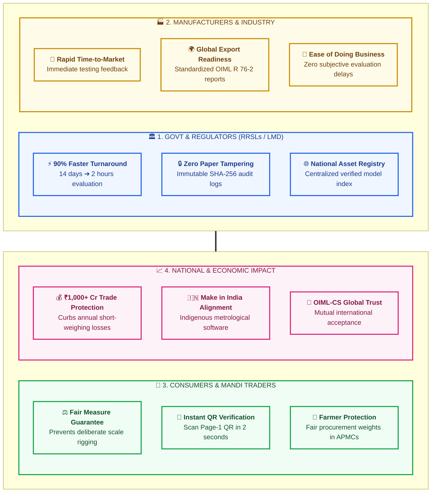

# Impact & Benefits — NAWI-R76 Platform
> **Smart India Hackathon (SIH) — Slide Blueprint & Visuals**
> *Designed for high visual impact, quantitative metrics, and 16:9 PowerPoint slide formatting.*

---

## 1. Executive Visual: The 4-Stakeholder Impact Matrix (16:9 Grid)

This visual organizes the impact across the 4 key beneficiary groups in a balanced 2×2 grid that fits PowerPoint slides without vertical stretching:



---

## 2. Big-Number Impact Stat Cards (PowerPoint Eye-Catchers)

In SIH, **numbers sell the impact**. Place these 4 prominent stat cards in a horizontal row across your slide:

```
┌─────────────────┐   ┌─────────────────┐   ┌─────────────────┐   ┌─────────────────┐
│     ⏱️ 90%      │   │     🛡️ 100%     │   │     ⚡ < 3s     │   │    ₹ 0 Lakhs    │
│ TIME REDUCTION  │   │  TAMPER-PROOF   │   │ FIELD QR SCAN   │   │  LICENSE FEES   │
│ 14 Days ➔ 2 Hrs │   │ SHA-256 Sealed  │   │ Instant Lookup  │   │   Open-Source   │
└─────────────────┘   └─────────────────┘   └─────────────────┘   └─────────────────┘
```

---

## 3. Detailed Stakeholder Benefits

### 1. Government & Legal Metrology Regulators
* **RRSLs (Regional Reference Standard Labs):** Testing throughput increases by **$5\times$**, clearing backlogs of pending commercial scale approvals.
* **Tamper-Evident Accountability:** Every test observation, correction, and retest records the exact metrologist ID, timestamp, and reasoning.
* **Elimination of Counterfeit Certificates:** Fake or forged certificates cannot be verified against the cryptographic registry.

### 2. Manufacturers & "Make in India"
* **Accelerated Product Launches:** Eliminates weeks of waiting for manual clerical report generation.
* **Global Acceptance:** Generates international-grade **OIML R 76-2 bilingual reports (English/French/Hindi)** ready for global export markets.
* **Predictable & Transparent:** Automated Table 6 MPE calculations eliminate human dispute and subjective rejection.

### 3. Fair Trade & Consumer Protection
* **Agricultural Mandis (APMCs):** Ensures farmers get paid for exact harvest weights, preventing the estimated 2–5% short-weighing losses in agricultural trading.
* **Retail & Supermarkets:** Consumers can visually verify scale authenticity using their own smartphone camera via the Page-1 QR code.
* **Port & Customs Inspections:** Enforcement officers can instantly verify freight and container weighbridge certificates offline and online.

### 4. Economic & Societal Value
* **Prevents Economic Leakage:** Commercial weighing touches ₹50+ Lakh Crores of annual GDP in India (retail, agriculture, logistics). A 0.1% accuracy enhancement saves thousands of crores from unrecorded leakage.
* **Zero Sovereign Licensing Drain:** Unlike foreign proprietary metrology suites costing ₹10–15 Lakhs per laboratory, NAWI-R76 runs on modern open-source stacks (Next.js, Node Crypto, PostgreSQL).

---

## 4. Before vs. After Comparison Table

| Metric / Dimension | 🔴 Traditional Paper & Excel Process | 🟢 NAWI-R76 Digital Platform |
|:---|:---|:---|
| **Report Generation Time** | 7 to 14 days (manual typing & drafting) | **< 2 seconds (instant PDF/DOCX)** |
| **Calculation Accuracy** | Vulnerable to manual calculation errors | **100% deterministic OIML physics** |
| **Evidence Traceability** | Disconnected photos or no photo records | **OCR-linked display photos with SHA-256** |
| **Field Certificate Verification** | 3 to 5 days (manual office dispatch) | **< 3 seconds (smartphone QR scan)** |
| **Fraud & Tampering Risk** | High (paper seals easily forged) | **Zero (cryptographic RSA/SHA-256 seal)** |
| **Revision History** | Overwritten spreadsheets; lost history | **Full traceable retest & audit trail** |

---

## 5. 30-Second Speaking Script for this Slide

> *"Judges, the impact of NAWI-R76 spans all four key pillars of our economy:
> 1. **For Regulators & RRSLs**, we slash type evaluation turnaround by **90%**—from two weeks down to two hours with zero paper tampering.
> 2. **For Indian Scale Manufacturers**, we accelerate time-to-market and provide globally accepted OIML R 76-2 documentation supporting Make in India exports.
> 3. **For Consumers & Farmers**, anyone can scan the Page-1 QR code in **under 3 seconds** to verify scale integrity, eliminating mandi short-weighing.
> 4. **Economically**, it protects thousands of crores in commercial trade with zero proprietary software licensing cost."*
